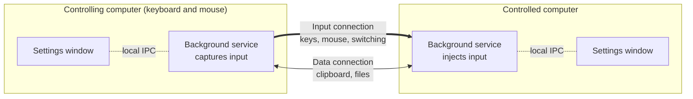
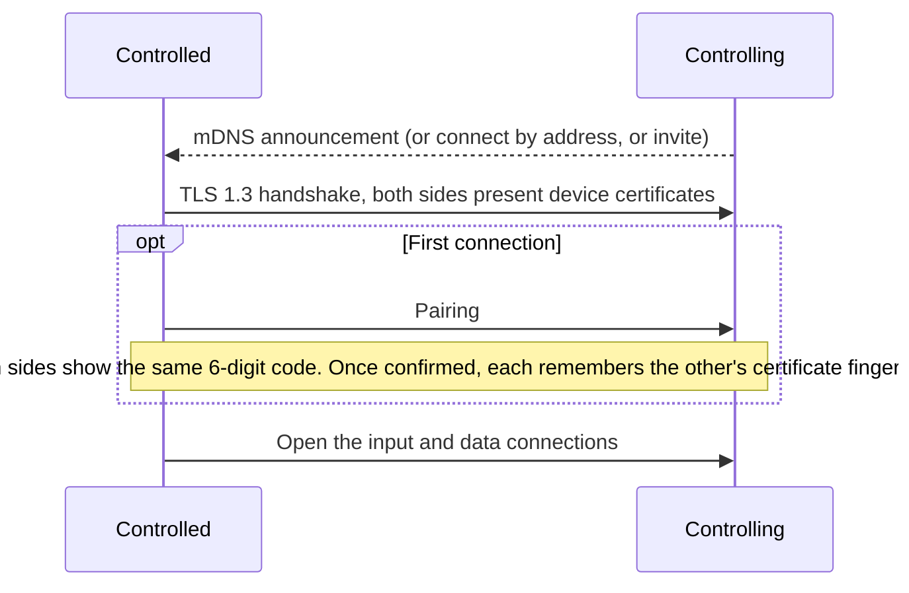
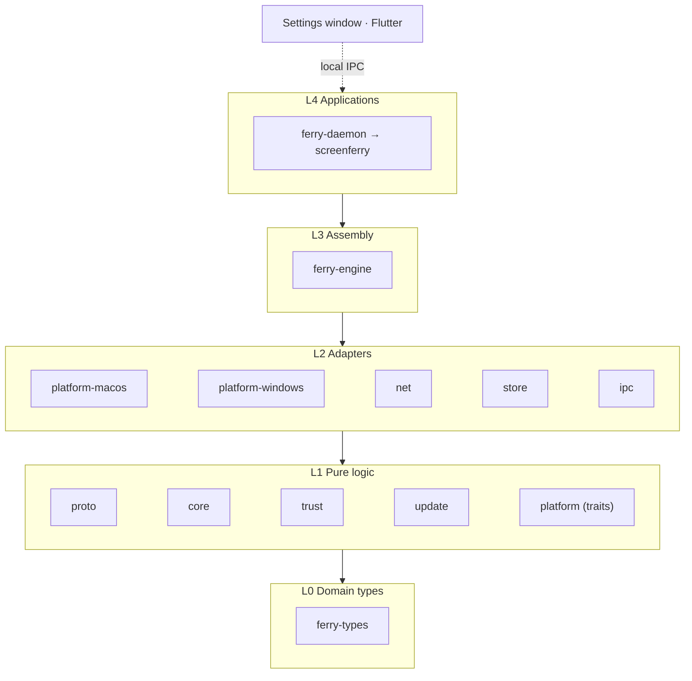

<picture>
  <source media="(prefers-color-scheme: dark)" srcset="assets/readme/hero-en-dark.png">
  
</picture>

[](https://github.com/icloudza/screen-ferry/actions/workflows/ci.yml)
[](#license)

English | [简体中文](README.zh-CN.md)

One keyboard and mouse for several computers. ScreenFerry shares a keyboard and mouse between your computers, Mac or Windows in any combination, syncs the clipboard and sends files, all over TLS 1.3.

## Features

- **Keyboard and mouse sharing**: push the cursor off a screen edge to move to the next computer. Keys travel as physical keys, so keyboard layouts and input methods don't get in the way. Caps Lock stays in sync and media keys are forwarded.
- **Many computers, either direction**: any computer can be the controlling one, and one can control several, arranged on any side.
- **Clipboard**: plain text, formatted text and images, synced when the cursor moves over.
- **Files**: drag them to a screen edge to send. Interrupted transfers resume after reconnecting.
- **Per-device settings**: pointer speed (DPI), scroll direction and speed, modifier keys and key mappings, accidental-switch protection.
- **Secure**: confirm a 6-digit pairing code the first time, then only the paired certificate fingerprint is trusted.
- **Easy to connect**: automatic discovery on the local network. Where discovery is blocked, connect by address or invite from the controlling computer.
- **Lightweight**: a Rust background service in the tray. The settings window starts on demand and exits when closed.
- **Automatic updates**: checks once a day, downloads in the background, and installs when you choose Restart to Update. Every update is signature-checked first.
- **English and Chinese**: the settings window, tray menu and installer come in English and Simplified Chinese. They follow the system language, and you can switch in Settings → Appearance.

## How it works



Each computer runs a background service that captures or injects input and handles networking and sync. The settings window is a separate process that talks to it over loopback.
Each pair of devices keeps two TLS 1.3 connections, so a large file transfer never slows down the keyboard and mouse.

Trust is set up on the first connection:



## Install

| System | How |
|---|---|
| macOS | Download `ScreenFerry-<version>-macos-universal.dmg` from [Releases](https://github.com/icloudza/screen-ferry/releases/latest), open it and drag ScreenFerry into Applications. On first launch, allow ScreenFerry in System Settings → Privacy & Security → Accessibility. |
| Windows | Download `ScreenFerry-<version>-windows-x64-setup.exe` from [Releases](https://github.com/icloudza/screen-ferry/releases/latest) and run it. |

ScreenFerry checks for updates once a day and downloads them in the background. Choose Restart to Update when it suits you; you can turn automatic checks off in Settings → About. Updates are verified against a built-in signing key before anything is installed.

About the Windows installer:

- It isn't code-signed. If SmartScreen blocks it, choose More info → Run anyway.
- It installs into Program Files and allows ScreenFerry through the firewall on private and domain networks.
- The background service runs with administrator rights so it can control windows of apps that run as administrator.
  The installer starts it elevated, and with Start at Login on, a highest-privilege scheduled task takes over at
  logon. Launching the app by hand only asks that task to start the service, so no administrator prompt appears.
  The one exception is a direct run with no task registered (a development build).
  The settings window and command-line commands run without elevation; use an administrator terminal if you need to
  debug an administrator app with `serve` or `connect`.
- Updates install silently: the background already runs as administrator, so there is no extra prompt. Uninstall from Settings → Apps; your settings and pairings are kept.

## Usage

1. Open ScreenFerry on both computers. By default a Mac controls and a Windows PC is controlled; change this in Settings → This Computer. When both computers run the same system, set the one without the keyboard and mouse to Be Controlled.
2. On the controlled computer, choose the controlling one on the Devices page and confirm the 6-digit pairing code on both sides. If it isn't found on the network, use Connect by Address, or Invite a Computer from the controlling one. The address is at the top of the other computer's Devices page.
3. On the controlling computer, arrange the screens on the Layout page, then push the cursor off a screen edge to move over.

If something goes wrong, export a diagnostics file from Log → Diagnostics and attach it when you [report an issue](https://github.com/icloudza/screen-ferry/issues/new?template=bug_report.yml).
Device names, user names and file names are replaced with placeholders.

While the cursor is on another screen, press <kbd>Ctrl</kbd>+<kbd>Option</kbd>+<kbd>Esc</kbd> (<kbd>Ctrl</kbd>+<kbd>Alt</kbd>+<kbd>Esc</kbd> when Windows controls) to bring it back.
Quit other keyboard and mouse sharing tools first so they don't compete for input.

### Command line

| Command | What it does |
|---|---|
| `screenferry` | Run in the background with a tray icon and open the settings window |
| `screenferry send <file>…` | Send files or folders to the connected computer |
| `screenferry peers` / `forget <device>` | List or remove paired devices |
| `screenferry quit` | Quit the running ScreenFerry |
| `screenferry serve` / `connect [address]` | Run in the terminal without the saved settings (for debugging) |

See `screenferry --help` for all options. The command line and diagnostics log are in Chinese.

### Where data lives

| | macOS | Windows |
|---|---|---|
| Settings, pairings | `~/Library/Application Support/ScreenFerry/` | `%APPDATA%\ScreenFerry\` |
| Logs, runtime files | `~/Library/Caches/ScreenFerry/` | `%LOCALAPPDATA%\ScreenFerry\` |

## Build from source

You need Rust (the version is pinned in `rust-toolchain.toml` and installed by rustup) and Flutter 3.47.
macOS also needs Xcode; Windows also needs Visual Studio 2022 (Desktop development with C++) and [Inno Setup](https://jrsoftware.org/isdl.php) 7.1 or later.

```bash
cargo xtask bundle
```

It builds for the system it runs on and puts the result in `target/bundle/`: `ScreenFerry.app` and its update package `ScreenFerry-<version>-macos-<arch>.zip` on macOS (add `--dmg` for the installer disk), `ScreenFerry-<version>-windows-x64-setup.exe` on Windows. Releases are made with `cargo xtask release <version>`; see ADR 0014.
On macOS the app is signed with a Developer ID certificate from the keychain when there is one (or the one named by `SCREENFERRY_SIGN_IDENTITY`). Otherwise it gets an ad-hoc signature, and Accessibility permission has to be granted again after every rebuild.

## Development



Each layer depends only on lower layers. `unsafe` appears only in `ferry-platform-*`, and system-specific code only there and in the L4 applications.

```bash
cargo test --workspace
cargo xtask lint
```

Run `flutter test` in `app/` for the settings window. The full pre-commit checklist is in [AGENTS.md](AGENTS.md).

The engineering docs are written in Chinese:

| Document | Contents |
|---|---|
| [AGENTS.md](AGENTS.md) | Engineering rules: layout, layers, naming, tests |
| [docs/architecture.md](docs/architecture.md) | Architecture overview and crate dependencies |
| [docs/protocol.md](docs/protocol.md) | Wire protocol |
| [docs/ipc.md](docs/ipc.md) | Local IPC between the settings window and the background service |
| [docs/adr/](docs/adr/) | Architecture decision records |

## License

Licensed under either [MIT](LICENSE-MIT) or [Apache-2.0](LICENSE-APACHE), at your option. Unless you state otherwise, any contribution you submit is licensed the same way.

## Friends

- [LINUX DO](https://linux.do/)
