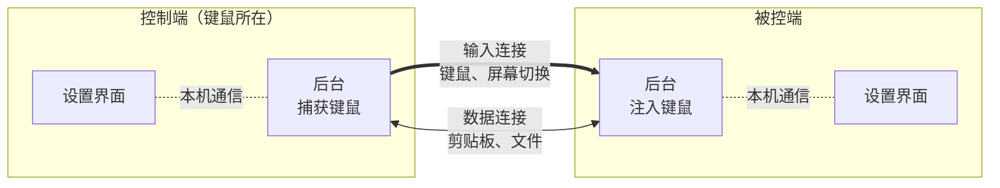
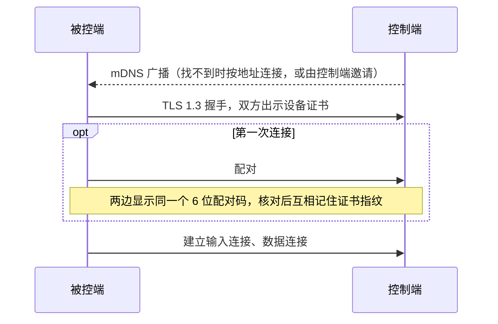
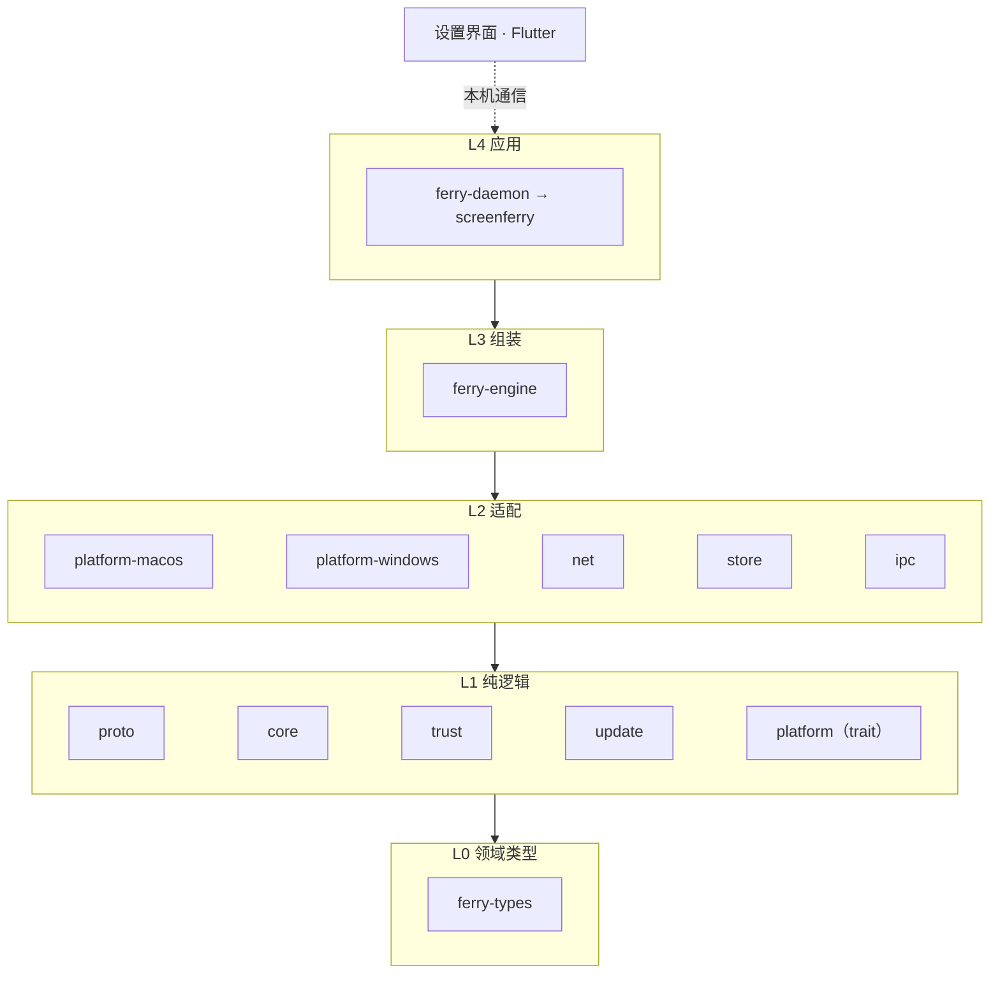

<picture>
  <source media="(prefers-color-scheme: dark)" srcset="assets/readme/hero-zh-dark.png">
  
</picture>

[](https://github.com/icloudza/screen-ferry/actions/workflows/ci.yml)
[](#许可证)

[English](README.md) | 简体中文

一套键盘鼠标控制多台电脑。ScreenFerry 在多台电脑之间共享键鼠（Mac、Windows 任意搭配），同步剪贴板、互传文件，连接全程 TLS 1.3 加密。

## 特性

- **键鼠共享**：光标推出屏幕边缘即切到另一台；按物理键传输，不受键盘布局和输入法影响；同步 Caps Lock，转发媒体键。
- **多台、双向**：任意一台都能当控制端，一台可以控制多台，按布局摆在上下左右。
- **剪贴板**：文字、带格式的文字、图片，光标切过去时才同步。
- **文件**：拖到屏幕边缘即发送，断线后接着传。
- **每台设备单独设置**：光标速度（DPI）、滚动方向与速度、修饰键与按键映射、防误切。
- **安全**：首次连接核对 6 位配对码，之后只认对方的证书指纹。
- **连得上**：局域网自动发现；网络不支持时按地址连接，或从控制端邀请。
- **轻量**：Rust 编写的后台常驻托盘；设置界面按需启动，关闭即退出。
- **自动更新**：每天检查一次，在后台下载好，你点“重启并更新”时安装；装之前先校验签名。
- **中英文**：界面、托盘菜单和安装程序有简体中文和英文，默认跟随系统，可以在“设置 → 外观”里切换。

## 工作方式



每台电脑上常驻一个后台，负责捕获或注入键鼠、网络与同步；设置界面是独立进程，经本机回环连接后台。
每对设备之间有两条 TLS 1.3 连接，传大文件不会拖慢键鼠。

首次连接时这样建立信任：



## 安装

| 系统 | 方式 |
|---|---|
| macOS | 在 [Releases](https://github.com/icloudza/screen-ferry/releases/latest) 下载 `ScreenFerry-<版本>-macos-universal.dmg`，打开后把 ScreenFerry 拖进“应用程序”。首次运行时在「系统设置 → 隐私与安全性 → 辅助功能」中允许 ScreenFerry。 |
| Windows | 在 [Releases](https://github.com/icloudza/screen-ferry/releases/latest) 下载 `ScreenFerry-<版本>-windows-x64-setup.exe` 并运行。 |

ScreenFerry 每天检查一次更新，有新版本时在后台下载好，你方便时点“重启并更新”即可；可以在“设置 → 关于”里关掉自动检查。安装前会用内置的签名公钥校验更新。

Windows 安装包：

- 没有代码签名，SmartScreen 拦截时点“更多信息 → 仍要运行”。
- 装进 Program Files，并在防火墙中放行专用网络和域网络。
- 后台以管理员权限运行，因此可以控制“以管理员身份运行”的软件。安装包装完就直接以管理员启动，
  开启“开机自动启动”后由一条最高权限的计划任务在登录时接管；以后双击图标启动，也只是请这条任务
  启动后台，都不会弹管理员确认。只有还没登记计划任务时（直接运行开发版本）才会弹一次。
  设置界面和命令行子命令不会自动提权；需要用 `serve`、`connect` 调试管理员软件时，请从管理员终端启动。
- 更新时后台已经是管理员权限，直接静默安装，不再弹出确认。卸载在“设置 → 应用”，配置和配对记录保留。

## 使用

1. 两台电脑都打开 ScreenFerry。默认 Mac 控制、Windows 被控制，可以在“设置 → 这台电脑”里改。两台是同一种系统时，把没接键鼠的那台改成“被控制”。
2. 在被控端的“设备”页选中控制端，两边核对 6 位配对码。局域网里找不到时，用“按地址连接”，或在控制端“邀请一台电脑”；地址在对方「设备」页顶部。
3. 在控制端的“布局”页摆好各台的位置，把光标推出屏幕边缘即可切过去。

出了问题时，在“日志 → 运行日志”里导出诊断文件，[提问题](https://github.com/icloudza/screen-ferry/issues/new?template=bug_report.yml)时附上它。
设备名、用户名和文件名会换成代号。

光标在对方屏幕上时，按 <kbd>Ctrl</kbd>+<kbd>Option</kbd>+<kbd>Esc</kbd>（Windows 控制时是 <kbd>Ctrl</kbd>+<kbd>Alt</kbd>+<kbd>Esc</kbd>）强制回到本机。
使用前请退出其他键鼠共享软件，避免争抢键鼠。

### 命令行

| 命令 | 作用 |
|---|---|
| `screenferry` | 常驻运行：托盘图标，打开设置界面 |
| `screenferry send <文件>…` | 把文件或文件夹发给连着的电脑 |
| `screenferry peers` / `forget <设备>` | 查看、删除已配对的设备 |
| `screenferry quit` | 退出正在运行的 ScreenFerry |
| `screenferry serve` / `connect [地址]` | 不读配置，在终端里直接运行（调试用） |

完整选项见 `screenferry --help`。

### 数据位置

| | macOS | Windows |
|---|---|---|
| 配置、配对记录 | `~/Library/Application Support/ScreenFerry/` | `%APPDATA%\ScreenFerry\` |
| 日志、运行时文件 | `~/Library/Caches/ScreenFerry/` | `%LOCALAPPDATA%\ScreenFerry\` |

## 从源码构建

需要 Rust（版本由 `rust-toolchain.toml` 固定，rustup 自动安装）和 Flutter 3.47。
macOS 另需 Xcode；Windows 另需 Visual Studio 2022（使用 C++ 的桌面开发）和 [Inno Setup](https://jrsoftware.org/isdl.php) 7.1 或更高版本。

```bash
cargo xtask bundle
```

在哪个系统上运行就打哪个系统的包，产物在 `target/bundle/`：macOS 是 `ScreenFerry.app` 和它的更新包 `ScreenFerry-<版本>-macos-<架构>.zip`（加 `--dmg` 另做安装盘），Windows 是 `ScreenFerry-<版本>-windows-x64-setup.exe`。发布用 `cargo xtask release <版本>`，见 ADR 0014。
macOS 上钥匙串里有 Developer ID 证书时自动签名（也可以用 `SCREENFERRY_SIGN_IDENTITY` 指定），否则用临时签名，每次重新打包都要重新授予辅助功能权限。

## 开发



每层只依赖更低的层；`unsafe` 只出现在 `ferry-platform-*` 里，按系统区分的代码只在它们和 L4 应用里。

```bash
cargo test --workspace
cargo xtask lint
```

设置界面的测试在 `app/` 下运行 `flutter test`。提交前的完整检查见 [AGENTS.md](AGENTS.md)。

| 文档 | 内容 |
|---|---|
| [AGENTS.md](AGENTS.md) | 工程规范：目录、分层、命名、测试 |
| [docs/architecture.md](docs/architecture.md) | 架构总览与 crate 依赖 |
| [docs/protocol.md](docs/protocol.md) | 线协议 |
| [docs/ipc.md](docs/ipc.md) | 设置界面与后台之间的本机通信 |
| [docs/adr/](docs/adr/) | 架构决策记录 |

## 许可证

[MIT](LICENSE-MIT) 或 [Apache-2.0](LICENSE-APACHE)，任选其一。除非另有声明，你提交的贡献同样按这两种许可证授权。

## 友情链接

- [LINUX DO](https://linux.do/)
