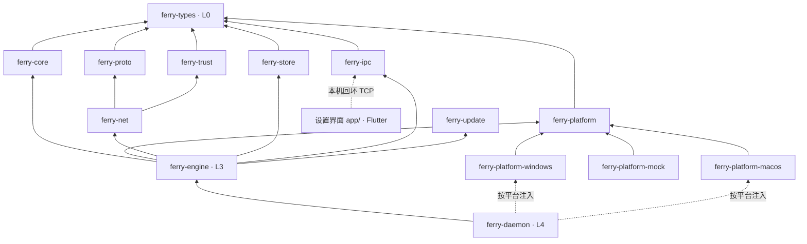

# 架构总览

工程规则（分层、依赖、命名、测试）以 [AGENTS.md](../AGENTS.md) 为准，本文只描述系统如何运作。

## 进程

| 进程 | 可执行文件 | 生命周期 | 职责 |
|---|---|---|---|
| 后台 | `screenferry` | 常驻 | 键鼠捕获与注入、网络、同步、托盘 |
| 设置界面 | Flutter 程序（`app/`） | 按需启动，关闭即退出 | 状态、设备与配对、布局、日志、设置 |

设置界面直接连接后台：后台监听 `127.0.0.1` 的随机端口，把端口和令牌写进缓存目录的 `ipc.json`，
界面读取后连接，每行一条 JSON（协议见 [ipc.md](ipc.md)，决策见 ADR 0004）。
后台推送完整的状态快照和日志，界面只发命令；配置只由后台写入。
界面文字有英文和简体中文（ADR 0013）：设置界面用 ARB 文件，托盘菜单和边缘胶囊由后台按当前语言写，
日志和提示带着结构化的 `phrase`，由界面按当前语言说。

后台常驻时主线程运行系统事件循环和托盘图标（托盘只能在主线程上操作），引擎与本机通信在另一个线程的
tokio 运行时里；托盘需要更新时，经 `ferry-platform` 的 `EventLoop` 把任务交给主线程。

后台不带参数时常驻运行（`ferry-engine` 的 `resident` 模块）：读 `config.toml` 启动引擎，
暂停共享即停止引擎，改了需要重新握手的设置就重启引擎，屏幕方向等设置即时生效；
首次配对的配对码在设置界面上核对。

Windows 的常驻后台以管理员权限运行：已经登记“登录时启动、最高权限”的任务计划程序任务时，普通
启动和登录自启都由这条任务启动，不弹 UAC；没有任务时才经一次 UAC 重新启动自己。设置界面和命令行
子命令仍按普通权限运行，见 ADR 0015。

## 网络连接

每对设备之间建立两条 TCP + TLS 1.3 连接，使用同一套设备证书双向认证。设备证书自签名，靠首次连接时核对配对码建立信任，之后只认对方证书的指纹（`ferry-trust` 计算，`ferry-store` 存于 `peers.toml`）：

| 连接 | 内容 | 要求 |
|---|---|---|
| 输入连接 | 键鼠事件、心跳、屏幕切换、控制命令 | 低延迟，`TCP_NODELAY`，不能被大数据堵塞 |
| 数据连接 | 剪贴板、图片、文件 | 分块传输，限速、限大小、可取消 |

连接都由客户端发起。客户端靠 mDNS 找到服务端，找不到时用信任列表里记下的地址，或者用户给的地址；
服务端也可以邀请客户端：连到客户端的邀请端口，请它连过来（ADR 0010）。

## crate 依赖

版本更新（ADR 0014）：`ferry-update` 校验更新清单的签名、判断有没有新版本，`ferry-net` 下载，
`ferry-platform` 的 `Updater` 由各平台安装（macOS 交换应用、Windows 运行安装包），`ferry-engine` 把它们串起来。

`ferry-engine` 只认识 `ferry-platform` 的 trait；`ferry-daemon` 在编译时按目标平台选择实现并注入。场景测试中用 `ferry-platform-mock` 替代真实平台。
